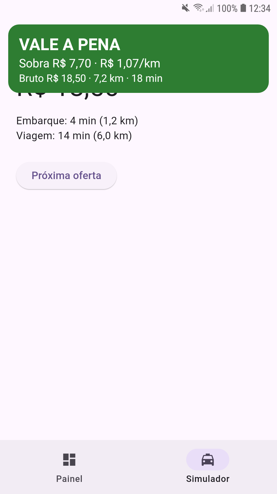
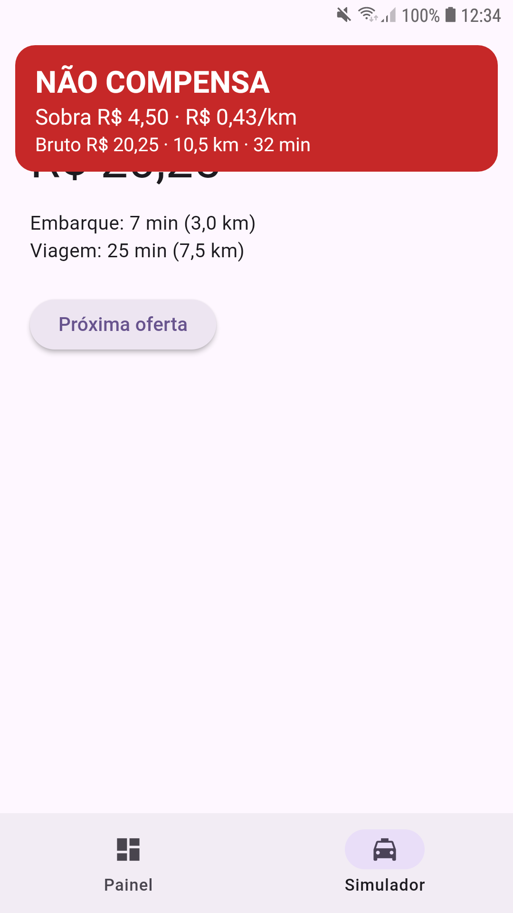
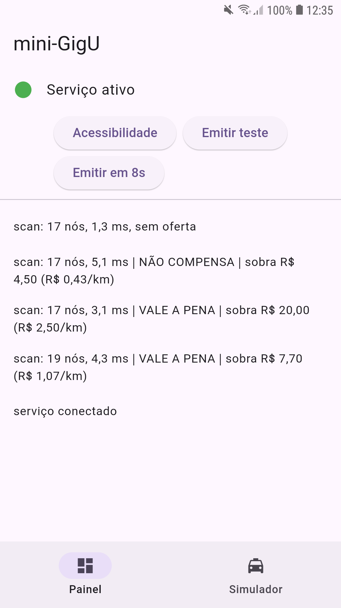

# mini-GigU (POC)

POC em Flutter + Android nativo (Kotlin) que **lê a tela de outro app com um `AccessibilityService`**, extrai uma oferta de corrida (valor, km, minutos), calcula **quanto sobra por km** e mostra um **card sobreposto** dizendo `VALE A PENA` ou `NÃO COMPENSA`.

> Projeto de estudo, feito para praticar Accessibility Services, overlays, integração Flutter ↔ nativo e serviços em background. Não tem vínculo com a GigU nem com qualquer app de corrida.

## Demo

<table>
  <tr>
    <td align="center"></td>
    <td align="center"></td>
    <td align="center"></td>
  </tr>
  <tr>
    <td align="center"><sub>Oferta que compensa</sub></td>
    <td align="center"><sub>Oferta que não compensa</sub></td>
    <td align="center"><sub>Painel: nós varridos e ms por scan</sub></td>
  </tr>
</table>

## O que a POC faz

1. O usuário ativa o serviço nas configurações de acessibilidade.
2. O serviço observa apenas os pacotes da allowlist e, a cada mudança de tela, varre a árvore de nós (`text` e `contentDescription`).
3. O `RideParser` extrai valor, km (embarque + viagem) e minutos dos textos.
4. O `evaluate` calcula `líquido = valor − km × custo_por_km` e decide se `líquido/km >= mínimo`.
5. Um card verde ou vermelho aparece no topo da tela e some sozinho em 5 s.
6. Como a demo não depende de um app de corrida real, o app tem um **simulador de ofertas** em Flutter que o próprio serviço consegue ler.

Parâmetros atuais (fixos no código): custo de **R$ 1,50/km**, mínimo líquido de **R$ 1,00/km**, pacote monitorado `com.rpstudio.gigu_poc`.

## Arquitetura

```
Flutter (UI)                          Android nativo (Kotlin)
┌───────────────────┐  MethodChannel  ┌──────────────────────────────────┐
│ Painel            │ ──────────────► │ MainActivity (channels)          │
│  - status         │  gigu_poc/      │  isServiceEnabled                │
│  - log            │  control        │  openAccessibilitySettings       │
│ Simulador         │                 │  getLog                          │
│  (ofertas fake)   │ ◄────────────── │                                  │
└───────────────────┘  EventChannel   ├──────────────────────────────────┤
                       gigu_poc/      │ RideAccessibilityService         │
                       events         │  throttle → coleta de textos     │
                                      │  → RideParser → evaluate         │
                                      │  → OverlayCard (WindowManager)   │
                                      ├──────────────────────────────────┤
                                      │ Bus (buffer em anel + sink)      │
                                      └──────────────────────────────────┘
```

| Arquivo | Responsabilidade |
| --- | --- |
| `lib/main.dart` | Painel (status, botões, log em tempo real) e simulador de ofertas |
| `MainActivity.kt` | `MethodChannel` e `EventChannel` |
| `Bus.kt` | Ponte em memória serviço → Flutter, com buffer de 200 eventos e entrega na main thread |
| `RideAccessibilityService.kt` | Throttle, varredura da árvore, dedup, orquestração |
| `RideParser.kt` | `parse` e `evaluate` em Kotlin puro (sem dependência de Android) |
| `OverlayCard.kt` | Card via `WindowManager` com `TYPE_ACCESSIBILITY_OVERLAY` |
| `res/layout/overlay_card.xml` | Layout do card |

## Decisões de design

| Tema | Escolha | Trade-off considerado |
| --- | --- | --- |
| Serviço → Flutter | Singleton `Bus` com buffer em anel | Simples e no mesmo processo; não sobrevive à morte do processo. `SharedFlow` seria a evolução natural |
| Parser | Regex sobre o texto | Independe de layout e de `viewIdResourceName` (que apps Flutter nem expõem); depende do formato do texto |
| Dinheiro e distância | `BigDecimal` criado a partir de `String` | Borda do veredito exata; mais verboso que `Double`. `Long` em centavos com value classes seria a alternativa se a medição pedisse |
| Veredito | Compara `líquido >= mínimo × km`, sem dividir | Exato e sem divisão por zero na decisão; a divisão só serve para exibir |
| Vários `R$` na tela | Vale o **primeiro** | Determinístico e testado; a ambiguidade deveria virar métrica |
| Km zero ou ausente | `parse` devolve `null` | Falha segura: sem card é melhor do que card errado |
| Eventos em rajada | **Throttle** com trailing edge de 300 ms | Debounce reiniciaria o relógio a cada evento e podia nunca escanear |
| Dedup | Compara o `RideOffer` parseado | Mais robusto que comparar a lista de textos; também evita o loop do serviço lendo a própria UI |
| Overlay | `View` inflada de XML | Compose exigiria `LifecycleOwner` manual num `Service`; segunda `FlutterEngine` custa RAM demais para um card estático |

### Pontos de atenção implementados

- **Performance:** throttle, limite de profundidade (15) e de nós (500), dedup. Medido no aparelho de teste: ~17 nós por scan, de 1,7 a 4 ms.
- **Lifecycle:** o card e os callbacks são removidos em `onInterrupt`, `onUnbind` e `onDestroy`. Desligar o serviço com o card visível remove o card na hora.
- **Permissões:** `TYPE_ACCESSIBILITY_OVERLAY` não exige `SYSTEM_ALERT_WINDOW`. `FLAG_NOT_TOUCHABLE` deixa os toques atravessarem o card, para não bloquear ações no app de baixo.
- **Privacidade:** só lê pacotes da allowlist (conferindo o pacote da janela lida) e nada sai do aparelho.
- **Observabilidade:** o log do painel mostra nós varridos e ms por scan.

## Como rodar

Requisitos: Flutter SDK, Android SDK e um aparelho Android com depuração USB (ou emulador com Google APIs). Testado em um **Samsung Galaxy S7 com Android 8.0**.

```bash
flutter pub get
flutter run -d <id-do-aparelho>
```

1. No app, toque em **Acessibilidade**, abra *Serviços instalados*, ligue **mini-GigU** e confirme o aviso.
2. Volte ao app: o indicador do painel deve ficar verde.
3. Abra a aba **Simulador**: em menos de 1 s deve aparecer o card. Toque em **Próxima oferta** para alternar entre as ofertas.

Observações:

- A cada `flutter run` o APK é reinstalado e o Android desliga o serviço, então é preciso reativá-lo. Mudanças só em Dart (hot reload/restart) não têm esse efeito.
- Em **Android 13+** com o app instalado fora da Play Store, pode ser necessário liberar *Permitir configurações restritas* nas informações do app antes de ativar o serviço.
- Alguns fabricantes (Xiaomi, Samsung etc.) encerram serviços em segundo plano; se isso ocorrer, remova o app da otimização de bateria.

## Testes

O parser e o cálculo ficam em Kotlin puro e são testados na JVM, sem aparelho:

```bash
cd android && ./gradlew :app:testDebugUnitTest
```

Cobertura principal: milhar em pt-BR (`R$ 1.250,00`), soma de km e minutos, ruído misturado nos textos, ausência de valor, km ou minutos, regra do primeiro `R$`, km zero, limite exato do veredito e um centavo abaixo dele.

## Limitações conhecidas

- Configuração (custo por km, mínimo, pacotes) fixa no código; sem tela de configuração nem persistência.
- Só o próprio simulador é monitorado; os pacotes de apps de corrida reais não foram verificados.
- Os minutos são somados de qualquer `N min` na tela, então texto de ruído com minutos entra na conta. Ancorar nos rótulos `Embarque:`/`Viagem:` reduziria isso.
- Minutos ausentes valem `0`; quem consumir esse campo precisa saber que `0` pode significar "ausente".
- Se mais de um `R$` aparecer, vale o primeiro, sem métrica de quantas vezes isso acontece.
- O `Bus` vive no processo: se o sistema matar o app, o log some.
- Posição do card fixa no topo; pode cobrir conteúdo do app alvo.
- Para publicação, a Accessibility API exige divulgação clara dentro do app, consentimento e declaração de uso na Play Console.

## Próximos passos

- Tela de configuração persistida (`SharedPreferences`/`DataStore`) com custo, mínimo e lista de pacotes.
- Verificar pacotes de apps reais e capturar árvores de nós como fixtures de teste.
- Telemetria de ambiguidade de preço e de falha de parse.
- Configuração remota por app, com rollout gradual.
- Posição do card configurável.
